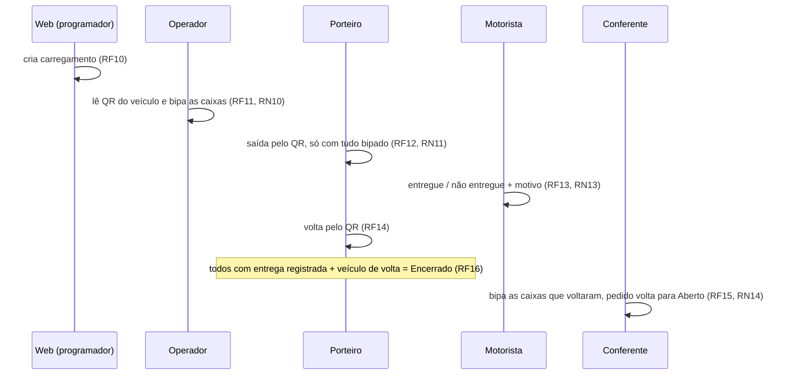

# API do aplicativo (Pim.Api)

> Referências: [[requisitos-funcionais]], [[regras-de-negocio]], [[00-visao-geral]].
> Minimal API em `src/Pim.Api`. Usa os **mesmos serviços do `Pim.Core`** que o Web, então as regras são as mesmas.

## Rodar

```fish
cd ~/dev/studies/university/PIM04/src
docker start pim-sql
dotnet run --project Pim.Api
```

- Endereço: `http://<ip-do-computador>:5090` (escuta em `0.0.0.0`, então o celular na mesma rede Wi-Fi acessa). No emulador Android, use `http://10.0.2.2:5090`.
- Swagger: `http://localhost:5090/swagger`
- Exemplos prontos: `src/Pim.Api/Pim.Api.http`
- Ao subir, a API aplica as migrations e coloca os dados de teste, igual ao Web.

## Login e erros

| Situação | Resposta |
|---|---|
| Login certo | `200 { "token", "nome", "perfil", "expiraEm" }`, com token JWT válido por 12h |
| Sem token / token vencido | `401` |
| Perfil sem acesso à rota | `403` |
| Regra de negócio violada | `400 { "erro": "RN11: faltam 8 caixas para bipar..." }` |

Toda rota (menos o login) exige o cabeçalho `Authorization: Bearer <token>`.
Só os perfis do app entram: **conferente, operador, porteiro, motorista** (senha `123456`). Os outros perfis recebem "Este perfil usa o sistema Web.".

## Rotas

| Método e rota | Perfil | Corpo | RF / RN |
|---|---|---|---|
| `POST /auth/login` | — | `{ login, senha }` | RF01 |
| `POST /portaria/chegada-fornecedor` | Porteiro | `{ placa }` | RF05 |
| `POST /recebimentos` | Conferente | `{ chaveNota }` (código de barras do DANFE) | RF06 |
| `GET /recebimentos/{id}` | Conferente | — | RF07 |
| `POST /recebimentos/{id}/caixas` | Conferente | `{ codigoProduto }` (EAN) | RF06, RN01, RN02 |
| `POST /recebimentos/{id}/finalizar` | Conferente | — | RF07, RN03 |
| `GET /carregamentos/veiculo?qr=VEICULO:2` | Operador | — | RF11 |
| `POST /carregamentos/{id}/caixas` | Operador | `{ codigoCaixa }` | RF11, RN10 |
| `POST /portaria/saida` | Porteiro | `{ qr }` | RF12, RN11, RN12 |
| `GET /entregas` | Motorista | — | RF13 |
| `POST /entregas/{id}` | Motorista | `{ entregue, motivo }` | RF13, RN13, RF16 |
| `POST /portaria/volta` | Porteiro | `{ qr }` | RF14, RN12, RF16 |
| `POST /retornos/caixas` | Conferente | `{ codigoCaixa }` | RF15, RN14 |

O QR Code do veículo é o mesmo impresso pelo Web: o texto `VEICULO:{id}`.

## Respostas principais

**Entrada** (`POST /recebimentos`, `GET /recebimentos/{id}`, `.../finalizar`):
```json
{ "id": 3, "notaNumero": 9010, "fornecedor": "Fornecedor Alfa Ltda", "status": "EmAndamento",
  "linhas": [ { "produto": "Produto B", "naNota": 5, "bipadas": 2, "diferenca": -3 } ] }
```

**Caixa bipada na entrada** (`POST /recebimentos/{id}/caixas`): `{ "codigoCaixa": "CX00000039", "produto": "Produto B" }`. O app mostra o código para a etiqueta (RN01).

**Carregamento** (`GET /carregamentos/veiculo`, `POST /carregamentos/{id}/caixas`, `/portaria/saida`, `/portaria/volta`):
```json
{ "id": 1, "placa": "DEF4G56", "motorista": "Marcos Silva", "dataPrevista": "2026-11-08T00:00:00",
  "status": "Planejado", "totalCaixas": 20, "caixasBipadas": 12,
  "faltando": [ { "pedidoNumero": 5002, "produto": "Produto C", "codigoProduto": "7891000300309", "faltam": 3 } ] }
```

**Entregas** (`GET /entregas`, `POST /entregas/{id}`):
```json
{ "carregamentoId": 1, "placa": "DEF4G56", "dataSaida": "...", "status": "EmRota",
  "pedidos": [ { "id": 1, "pedidoNumero": 5001, "cliente": "Mercado Bom Preço", "endereco": "Rua ..., 100 - Centro, São Paulo/SP",
                 "caixas": 12, "resultado": "Pendente", "motivo": null } ] }
```
O `id` de cada pedido é o que vai em `POST /entregas/{id}`.

**Retorno** (`POST /retornos/caixas`): `{ "codigo": "CX00000009", "pedidoNumero": 5002, "caixasFaltando": 0, "pedidoReaberto": true }`.

## Fluxo de um pedido pelo app



## Decisões

- **RN01:** a etiqueta é gerada pelo sistema na entrada (`CX` + 8 números, em sequência). O conferente bipa o código do produto, e o app mostra o código da caixa.
- **RN02:** caixa de produto que não está na nota é recusada. Caixa a mais de um produto da nota é aceita e aparece como diferença positiva, que o gerente aprova no Web (RN03).
- **RN10:** a caixa só sobe se o produto dela ainda falta em algum pedido do carregamento. O sistema liga a caixa a esse pedido.
- **RF16 / RN15:** o carregamento é encerrado quando todos os pedidos têm a entrega registrada **e** o veículo já voltou. Até lá ele continua "em rota", e por isso o veículo e o motorista continuam presos a ele (RN19).
- **RN14:** a caixa que volta fica livre no armazém (sem pedido e sem carregamento). O histórico guarda o retorno. Quando a última caixa do pedido volta, o pedido fica `Aberto` e pode entrar em outro carregamento.
