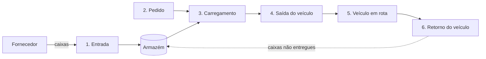

# Contexto Original — Distribuidora com frota própria

> Arquivo de referência do contexto. Descreve **como a empresa trabalha hoje (AS-IS)** e onde dá errado.
> Não traz requisitos nem solução: as **regras de negócio** saem das "perguntas para levantamento" de cada processo.
> A empresa é fictícia (item 2.4 do manual do PIM IV).

**Tema do PIM IV:** Desenvolvimento e Implantação de uma Solução Tecnológica Corporativa Integrada para Apoiar a Transformação Digital de uma Empresa.
**Recorte:** controle de **entrada e saída** (caixas e veículos), **pedidos**, **carregamentos** e **frota**.

---

## 1. A empresa

- Distribuidora que recebe mercadoria de fornecedores, guarda em um armazém e entrega aos clientes com **frota própria**.
- O que a empresa vende **não importa** para o sistema: tudo é tratado como **caixa** (volume com etiqueta/código de barras).
- Já existe um **ERP** (cadastro de clientes, financeiro, nota fiscal). O controle do dia a dia é feito em **papel, planilha e WhatsApp**.

| Área | Quem | O que faz |
|---|---|---|
| Comercial | Vendedores | Registra pedidos dos clientes |
| Armazém | Conferentes, operadores | Recebe, separa e carrega caixas |
| Portaria | Porteiro | Controla quem e o que entra e sai |
| Logística | Programador de cargas | Monta os carregamentos e escolhe veículo/motorista |
| Frota | Motoristas, responsável pela frota | Faz entregas, cuida dos veículos |
| Gestão | Gerente | Acompanha tudo e resolve problemas |

---

## 2. Visão geral

Os quatro módulos pensados:

| Módulo | Ideia |
|---|---|
| **Bipagem (mobile)** | Celular lê o código de barras de **caixas** e **veículos** sempre que algo entra ou sai |
| **Pedidos** | Registro do que o cliente pediu e acompanhamento até a entrega |
| **Carregamentos** | Agrupa pedidos/caixas em um veículo para uma viagem |
| **Frota** | Saber **onde cada veículo está** e em que situação |

---

## 3. Processos atuais (AS-IS)

### 3.1 Entrada de caixas

- **Como é hoje:** o caminhão do fornecedor chega, o conferente conta as caixas olhando a nota e anota divergências no papel. O lançamento é feito horas depois.
- **Onde dá errado:** contagem errada, lançamento atrasado, ninguém sabe quem recebeu.
- **Perguntas para levantamento:**
  - Toda caixa já vem com etiqueta ou a empresa precisa etiquetar?
  - Pode entrar caixa sem pedido de compra/nota?
  - O que acontece com caixa avariada ou sobrando/faltando?
  - Quem pode aceitar uma entrada com divergência?

### 3.2 Pedido do cliente

- **Como é hoje:** o vendedor registra o pedido no ERP e avisa o armazém por e-mail ou impresso. Ninguém acompanha em que etapa ele está.
- **Onde dá errado:** cliente liga perguntando "cadê meu pedido?" e ninguém sabe responder; pedido esquecido.
- **Perguntas para levantamento:**
  - Por quais situações (status) um pedido passa? Ex.: aberto → separado → carregado → em rota → entregue.
  - Até quando o pedido pode ser alterado ou cancelado?
  - Um pedido pode ser dividido em mais de um carregamento?
  - Existe prioridade entre pedidos/clientes?

### 3.3 Carregamento

- **Como é hoje:** o programador de cargas monta as viagens numa planilha, agrupando por região "de cabeça". Os operadores carregam o caminhão olhando uma folha impressa.
- **Onde dá errado:** caixa de um pedido vai no caminhão errado ou fica para trás; caminhão sai com excesso de peso ou meio vazio.
- **Perguntas para levantamento:**
  - Quais informações definem um carregamento (veículo, motorista, data, rota, pedidos)?
  - O veículo tem limite de peso/volume/quantidade de caixas? O sistema deve bloquear se passar?
  - Toda caixa precisa ser bipada ao entrar no veículo? E se for bipada a caixa errada?
  - Um carregamento pode ser alterado depois de iniciado?

### 3.4 Saída do veículo (portaria)

- **Como é hoje:** o porteiro anota a placa e o horário num caderno. Não confere se o carregamento está completo.
- **Onde dá errado:** veículo sai com carga incompleta; não há registro confiável de horário.
- **Perguntas para levantamento:**
  - O veículo só pode sair se todas as caixas do carregamento foram bipadas?
  - Quem libera a saída?
  - O que é registrado na saída (placa, motorista, horário, quilometragem)?

### 3.5 Veículo em rota e entrega

- **Como é hoje:** o motorista avisa pelo WhatsApp quando entrega. O comprovante assinado só volta no fim do dia.
- **Onde dá errado:** não se sabe onde o veículo está nem quais pedidos já foram entregues.
- **Perguntas para levantamento:**
  - "Onde o veículo está" significa localização (GPS) ou situação (no pátio, carregando, em rota, em manutenção)?
  - O motorista registra cada entrega no celular? Bipa as caixas na entrega?
  - O que fazer quando o cliente recusa ou não está no local?

### 3.6 Retorno do veículo

- **Como é hoje:** o veículo volta, o porteiro anota a hora; caixas não entregues são deixadas num canto.
- **Onde dá errado:** caixas que voltaram "somem"; pedido continua como "em rota" para sempre.
- **Perguntas para levantamento:**
  - As caixas que voltam são bipadas de novo na entrada?
  - O pedido não entregue volta a ficar disponível para outro carregamento?
  - Quando o carregamento é considerado encerrado?

### 3.7 Controle da frota

- **Como é hoje:** uma planilha com placas e um quadro na parede com quem está com qual veículo.
- **Onde dá errado:** veículo em manutenção é escalado para viagem; motorista sem CNH válida dirige.
- **Perguntas para levantamento:**
  - Quais situações um veículo pode ter? Quem muda essa situação?
  - Veículo em manutenção pode ser usado em carregamento?
  - O motorista precisa estar cadastrado e com CNH válida para ser escalado?
  - Um motorista/veículo pode estar em dois carregamentos ao mesmo tempo?

---

## 4. Problemas identificados

| # | Situação atual | Consequência |
|---|---|---|
| P1 | Entrada e saída anotadas no papel | Sem histórico confiável de quem, quando e o quê |
| P2 | Pedido sem acompanhamento de status | Cliente sem resposta, pedidos esquecidos |
| P3 | Carregamento montado em planilha e conferido no olho | Caixa no veículo errado ou deixada para trás |
| P4 | Portaria não confere a carga | Veículo sai incompleto |
| P5 | Ninguém sabe onde cada veículo está | Atrasos, escala errada de veículo/motorista |
| P6 | Retorno sem registro | Caixas "somem", pedidos sem fim |

**Problema central:** falta de **rastreabilidade** das caixas e dos veículos, do momento em que entram até o momento em que saem.

---

## 5. Restrições

- O **ERP continua**: nota fiscal, financeiro e cadastro de clientes são dele. A integração pode ser **simulada**.
- Operadores, porteiro e motoristas usam **celular** (leitura de código de barras pela câmera). Pode haver sinal ruim.
- Gestão, comercial e logística usam **computador (Web)**.
- Dados pessoais (clientes, motoristas) seguem a **LGPD**.
- Deve ser acessível para pessoas com pouca familiaridade digital e com deficiência.

---

## 6. Fora do recorte

- Emissão real de nota fiscal (fica com o ERP).
- Roteirização/otimização de rotas.
- Controle de estoque por prateleira/endereço, lote e validade.
- Financeiro, custos de frete, abastecimento.

---

## 7. Glossário

| Termo | Significado |
|---|---|
| Caixa / Volume | Unidade física com código de barras; é o que o sistema rastreia |
| Bipar | Ler o código de barras com o celular |
| Pedido | O que o cliente solicitou; contém uma ou mais caixas |
| Carregamento | Uma viagem: um veículo + motorista + conjunto de pedidos/caixas |
| Veículo | Caminhão/van da frota própria, identificado pela placa (ou etiqueta) |
| Situação do veículo | Ex.: disponível, carregando, em rota, em manutenção |
| Portaria | Ponto onde se registra entrada e saída de veículos |
| ERP | Sistema de gestão que a empresa já usa |
