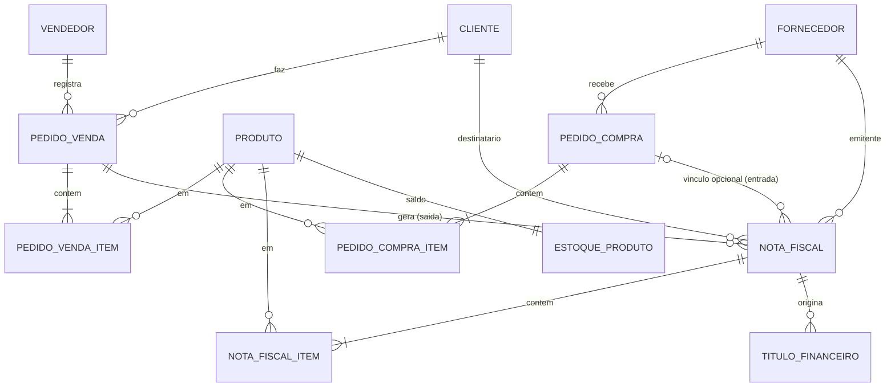

# ERP atual — Tabelas

> Documento de apoio. Descreve as **tabelas que já existem no ERP** da distribuidora (fictício).
> O ERP **não faz parte do desenvolvimento**: o novo sistema só **lê** (ou recebe) esses dados por integração, que pode ser **simulada** (seção 5 do contexto).
> Regras de comportamento do ERP: ver [[erp-regras-de-negocio]].

---

## 1. Visão geral

| # | Tabela | Para que serve | Interessa ao novo sistema? |
|---|---|---|---|
| 1 | `cliente` | Cadastro de clientes | **Sim** (destino da entrega) |
| 2 | `fornecedor` | Cadastro de fornecedores | **Sim** (origem da entrada) |
| 3 | `produto` | Cadastro de produtos (o que vem dentro da caixa) | **Sim** (código de barras, peso, volume) |
| 4 | `vendedor` | Vendedores do comercial | Pouco (só exibição) |
| 5 | `pedido_venda` | Pedido do cliente | **Sim** |
| 6 | `pedido_venda_item` | Itens do pedido (em caixas) | **Sim** |
| 7 | `pedido_compra` | Pedido feito ao fornecedor | **Sim** (conferência da entrada) |
| 8 | `pedido_compra_item` | Itens do pedido de compra | **Sim** |
| 9 | `nota_fiscal` | NF-e de entrada e de saída | **Sim** |
| 10 | `nota_fiscal_item` | Itens da NF-e | **Sim** |
| 11 | `estoque_produto` | Saldo de caixas por produto | Consulta |
| 12 | `titulo_financeiro` | Contas a receber/pagar | **Não** (fora do recorte) |
| 13 | `usuario` | Usuários e perfis do ERP | Não |

---

## 2. Tabelas

Convenções: **PK** = chave primária, **FK** = chave estrangeira, **Obr.** = obrigatório.

### 2.1 `cliente`

| Campo | Tipo | Obr. | Descrição |
|---|---|---|---|
| id_cliente | inteiro | PK | Identificador interno |
| tipo_pessoa | texto(1) | Sim | `F` (física) ou `J` (jurídica) |
| cpf_cnpj | texto(14) | Sim | Único. **Dado pessoal quando PF (LGPD)** |
| razao_social | texto(150) | Sim | Nome / razão social |
| nome_fantasia | texto(150) | Não | |
| inscricao_estadual | texto(20) | Não | |
| telefone | texto(20) | Não | Dado pessoal (LGPD) |
| email | texto(120) | Não | Dado pessoal (LGPD) |
| logradouro, numero, complemento, bairro | texto | Sim* | Endereço principal (*complemento opcional) |
| cidade | texto(80) | Sim | |
| uf | texto(2) | Sim | |
| cep | texto(8) | Sim | |
| regiao | texto(30) | Não | Região comercial (ex.: "Zona Norte"). Preenchida de forma irregular |
| limite_credito | decimal(12,2) | Sim | Usado ao salvar pedido |
| situacao | texto(10) | Sim | `ATIVO`, `BLOQUEADO`, `INATIVO` |
| data_cadastro | data | Sim | |

### 2.2 `fornecedor`

| Campo | Tipo | Obr. | Descrição |
|---|---|---|---|
| id_fornecedor | inteiro | PK | |
| cnpj | texto(14) | Sim | Único |
| razao_social | texto(150) | Sim | |
| nome_fantasia | texto(150) | Não | |
| inscricao_estadual | texto(20) | Não | |
| telefone, email | texto | Não | |
| endereço (mesmos campos do cliente) | texto | Sim | |
| situacao | texto(10) | Sim | `ATIVO`, `INATIVO` |

### 2.3 `produto`

| Campo | Tipo | Obr. | Descrição |
|---|---|---|---|
| id_produto | inteiro | PK | |
| codigo_interno | texto(20) | Sim | SKU da empresa. Único |
| descricao | texto(150) | Sim | |
| codigo_barras_caixa | texto(14) | Não | EAN-13 / DUN-14 do fornecedor. **Identifica o produto, não a caixa**: todas as caixas do mesmo produto têm o mesmo código |
| id_fornecedor_padrao | inteiro | FK | Fornecedor principal |
| ncm | texto(8) | Sim | Classificação fiscal |
| peso_bruto_caixa_kg | decimal(8,3) | **Não** | Peso de uma caixa. Cerca de 30% dos produtos estão sem esse dado |
| volume_caixa_m3 | decimal(8,4) | **Não** | Volume de uma caixa. Mesmo problema do peso |
| preco_venda | decimal(12,2) | Sim | Preço por caixa |
| situacao | texto(10) | Sim | `ATIVO`, `INATIVO` |

### 2.4 `vendedor`

| Campo | Tipo | Obr. | Descrição |
|---|---|---|---|
| id_vendedor | inteiro | PK | |
| nome | texto(100) | Sim | |
| email | texto(120) | Sim | |
| telefone | texto(20) | Não | |
| id_usuario | inteiro | FK | Login no ERP |
| situacao | texto(10) | Sim | `ATIVO`, `INATIVO` |

### 2.5 `pedido_venda`

| Campo | Tipo | Obr. | Descrição |
|---|---|---|---|
| id_pedido | inteiro | PK | |
| numero | inteiro | Sim | Número exibido ao cliente. Único |
| id_cliente | inteiro | FK | |
| id_vendedor | inteiro | FK | |
| data_emissao | data/hora | Sim | |
| data_prevista_entrega | data | Não | Informada pelo vendedor, sem validação |
| endereco_entrega | texto(300) | Não | Se vazio, usa o endereço do cliente |
| status | texto(20) | Sim | `ABERTO`, `FATURADO_PARCIAL`, `FATURADO`, `CANCELADO` |
| bloqueado_credito | booleano | Sim | `true` se passou do limite de crédito e ainda não foi liberado |
| observacao | texto(500) | Não | Texto livre. Hoje é onde se escreve "URGENTE" |
| valor_total | decimal(12,2) | Sim | Calculado pelos itens |

### 2.6 `pedido_venda_item`

| Campo | Tipo | Obr. | Descrição |
|---|---|---|---|
| id_item | inteiro | PK | |
| id_pedido | inteiro | FK | |
| id_produto | inteiro | FK | |
| quantidade_caixas | inteiro | Sim | Quantidade pedida (sempre em caixas) |
| quantidade_faturada | inteiro | Sim | Quanto já saiu em NF (começa em 0) |
| preco_unitario | decimal(12,2) | Sim | Preço por caixa no momento do pedido |

### 2.7 `pedido_compra`

| Campo | Tipo | Obr. | Descrição |
|---|---|---|---|
| id_pedido_compra | inteiro | PK | |
| numero | inteiro | Sim | Único |
| id_fornecedor | inteiro | FK | |
| data_emissao | data | Sim | |
| data_prevista_chegada | data | Não | |
| status | texto(20) | Sim | `ABERTO`, `RECEBIDO_PARCIAL`, `RECEBIDO`, `CANCELADO` |

### 2.8 `pedido_compra_item`

| Campo | Tipo | Obr. | Descrição |
|---|---|---|---|
| id_item | inteiro | PK | |
| id_pedido_compra | inteiro | FK | |
| id_produto | inteiro | FK | |
| quantidade_caixas | inteiro | Sim | Quantidade pedida |
| quantidade_recebida | inteiro | Sim | Atualizada quando a NF de entrada é lançada **com vínculo** |

### 2.9 `nota_fiscal`

| Campo | Tipo | Obr. | Descrição |
|---|---|---|---|
| id_nf | inteiro | PK | |
| tipo | texto(10) | Sim | `ENTRADA`, `SAIDA`, `RETORNO` (mercadoria não entregue que volta), `DEVOLUCAO` (devolução ao fornecedor) |
| numero | inteiro | Sim | |
| serie | texto(3) | Sim | |
| chave_acesso | texto(44) | Sim | Chave da NF-e. Única. É o código de barras do DANFE |
| data_emissao | data/hora | Sim | |
| data_lancamento | data/hora | Sim | Quando foi registrada no ERP. Na entrada costuma ser horas depois da chegada |
| id_cliente | inteiro | FK | Preenchido em `SAIDA` / `RETORNO` |
| id_fornecedor | inteiro | FK | Preenchido em `ENTRADA` / `DEVOLUCAO` |
| id_pedido_venda | inteiro | FK | Preenchido em `SAIDA` / `RETORNO` |
| id_pedido_compra | inteiro | FK | **Opcional** em `ENTRADA` |
| qtd_volumes | inteiro | Sim | Total de caixas da nota |
| peso_bruto_kg | decimal(10,3) | Não | Total informado na nota |
| valor_total | decimal(12,2) | Sim | |
| situacao | texto(12) | Sim | `AUTORIZADA`, `CANCELADA` |

### 2.10 `nota_fiscal_item`

| Campo | Tipo | Obr. | Descrição |
|---|---|---|---|
| id_item | inteiro | PK | |
| id_nf | inteiro | FK | |
| id_produto | inteiro | FK | |
| quantidade_caixas | inteiro | Sim | |
| valor_unitario | decimal(12,2) | Sim | |

### 2.11 `estoque_produto`

| Campo | Tipo | Obr. | Descrição |
|---|---|---|---|
| id_produto | inteiro | PK/FK | Um registro por produto |
| saldo_caixas | inteiro | Sim | Pode ficar **negativo** (ver regras) |
| data_ultima_movimentacao | data/hora | Sim | |

### 2.12 `titulo_financeiro` (fora do recorte)

| Campo | Tipo | Obr. | Descrição |
|---|---|---|---|
| id_titulo | inteiro | PK | |
| tipo | texto(7) | Sim | `RECEBER`, `PAGAR` |
| id_nf | inteiro | FK | |
| vencimento | data | Sim | |
| valor | decimal(12,2) | Sim | |
| situacao | texto(10) | Sim | `ABERTO`, `PAGO`, `VENCIDO`, `CANCELADO` |

### 2.13 `usuario`

| Campo | Tipo | Obr. | Descrição |
|---|---|---|---|
| id_usuario | inteiro | PK | |
| login | texto(30) | Sim | Único |
| nome | texto(100) | Sim | |
| perfil | texto(15) | Sim | `VENDEDOR`, `COMPRAS`, `FATURAMENTO`, `FINANCEIRO`, `ADMIN` |
| ativo | booleano | Sim | |

---

## 3. O que **não existe** no ERP

Esses dados ficam hoje em papel, planilha ou WhatsApp. É o espaço do novo sistema:

| Informação | Onde está hoje |
|---|---|
| Caixa individual (identificação única de cada volume) | Não existe |
| Conferência e divergência do recebimento (falta, sobra, avaria) | Papel / verso da NF |
| Separação (qual caixa foi para qual pedido) | Não existe |
| Carregamento / viagem | Planilha da programadora de cargas |
| Veículos e situação de cada um | Planilha + quadro na parede |
| Motoristas e CNH | Planilha (motoristas não são usuários do ERP) |
| Entrada e saída de veículos na portaria | Caderno do porteiro |
| Status logístico do pedido (separado, carregado, em rota, entregue, não entregue) | Não existe. O ERP só sabe se foi faturado |
| Comprovante de entrega | Papel assinado, volta no fim do dia |

---

## 4. Pontos de integração (o que o novo sistema lê do ERP)

| Dado | Tabelas | Uso no novo sistema |
|---|---|---|
| Clientes | `cliente` | Destino e endereço de entrega |
| Fornecedores | `fornecedor` | Identificar a origem da entrada |
| Produtos | `produto` | Descrição, código de barras do fornecedor, peso/volume da caixa |
| Pedidos de venda | `pedido_venda`, `pedido_venda_item` | Base para separação e carregamento |
| Pedidos de compra | `pedido_compra`, `pedido_compra_item` | Conferir a entrada contra o que foi pedido |
| Notas fiscais | `nota_fiscal`, `nota_fiscal_item` | Conferir a entrada (pela chave de acesso) e saber o que cada pedido faturou |

---

## 5. Glossário (termos do ERP e fiscais)

> Complementa o glossário do [[contexto-original]].

| Termo | Significado |
|---|---|
| **NF-e** | Nota fiscal eletrônica. Documento fiscal obrigatório: **mercadoria não pode circular sem NF-e** |
| **DANFE** | Versão impressa da NF-e que viaja com a carga. Tem um código de barras com a chave de acesso |
| **Chave de acesso** | Número de 44 dígitos que identifica uma NF-e. Dá para bipar no DANFE |
| **NF de entrada** | Nota que o fornecedor emite e que chega junto com a mercadoria |
| **NF de saída** | Nota que a distribuidora emite para o cliente ao faturar o pedido |
| **NF de retorno** | Nota lançada quando a mercadoria saiu para entrega e **voltou** (cliente recusou ou estava ausente) |
| **NF de devolução** | Nota emitida para **devolver mercadoria ao fornecedor** (ex.: caixa avariada) |
| **Faturar** | Emitir a NF de saída de um pedido. Depois disso, o pedido está fiscalmente pronto para sair |
| **Faturamento parcial** | Faturar só parte das caixas do pedido. O pedido fica com mais de uma NF |
| **Pedido de venda** | O que o cliente comprou (chamado só de "pedido" no contexto) |
| **Pedido de compra** | O que a distribuidora encomendou do fornecedor |
| **Vínculo NF ↔ pedido de compra** | Ligação entre a nota que chegou e o pedido de compra que a originou. No ERP é **opcional** |
| **Saldo de estoque** | Quantidade de caixas de um produto que o ERP acha que existe, sem saber quais caixas |
| **SKU / código interno** | Código do produto dentro da empresa |
| **EAN-13 / DUN-14** | Códigos de barras padrão de mercado. **Identificam o produto, não a caixa individual** |
| **Peso bruto / volume da caixa** | Peso (kg) e espaço (m³) de **uma** caixa do produto, no cadastro do produto |
| **Limite de crédito** | Valor máximo em aberto que o cliente pode ter. Se passar, o pedido fica bloqueado |
| **Reabrir pedido** | Termo da operação: deixar um pedido não entregue **disponível de novo para outro carregamento** |
