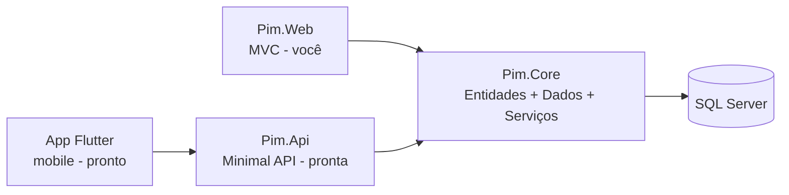

# 00 — Visão geral do passo a passo (Web)

> Cada arquivo é um passo de **mais ou menos 30 minutos**. Faça na ordem: cada passo usa o anterior.
> O código foi **compilado e testado** (login, cadastros, regras RN06 a RN19, triggers e procedures).
> **Sem estilo:** as telas são HTML puro. O Bootstrap entra depois, numa revisão separada.

## Passos

| Passo | Arquivo | O que você faz | Requisitos | Tempo |
|---|---|---|---|---|
| 01 | [[01-criar-projeto]] | Solução .NET + SQL Server no Docker | — | 30 min |
| 02 | [[02-entidades]] | Classes das tabelas | — | 30 min |
| 03 | [[03-banco-de-dados]] | DbContext + criar as tabelas | — | 20 min |
| 04 | [[04-dados-de-teste]] | Dados simulados do ERP | RF04 | 25 min |
| 05 | [[05-login-e-menu]] | Login, perfis e menu | RF01 | 35 min |
| 06 | [[06-veiculos]] | Veículos, manutenção e QR Code | RF02, RF17, RF18 | 35 min |
| 07 | [[07-motoristas]] | Motoristas e CNH | RF03 | 25 min |
| 08 | [[08-pedidos]] | Consulta e cancelamento de pedidos | RF08, RF09 | 30 min |
| 09 | [[09-carregamentos]] | Montar carregamento com as regras | RF10 | 40 min |
| 10 | [[10-recebimentos]] | Conferência e aprovação do gerente | RF07 | 30 min |
| 11 | [[11-painel-e-rastreio]] | Painel inicial e histórico da caixa | RF19 | 25 min |
| 12 | [[12-triggers-e-procedures]] | Triggers e procedures (Etapa 7 do manual) | — | 25 min |

**Total: cerca de 6 horas.** Se faltar tempo, o passo 12 é do banco, não do Web, e pode ficar para depois.

## Arquitetura

| Projeto | Camada | Conteúdo |
|---|---|---|
| `Pim.Core` | Domínio, regras e dados | `Entidades/` (classes), `Dados/` (DbContext, dados de teste), `Servicos/` (regras de negócio) |
| `Pim.Web` | Apresentação | Controllers e Views (telas do computador) |
| `Pim.Api` | Apresentação | Minimal API (JWT) para o app. **Reaproveita o `Pim.Core` inteiro**. Rotas em [[api]] |
| `app/` (Flutter) | Apresentação (mobile) | Telas do conferente, operador, porteiro e motorista. Fala só com a `Pim.Api`. Ver [[app]] |

As regras ficam nos **serviços** do `Pim.Core`. Assim a API usa as mesmas regras sem copiar código.

## O que fica no Web e o que fica no app

| Web (este passo a passo) | App (pronto, ver [[app]]) + API (pronta, ver [[api]]) |
|---|---|
| RF01 login · RF02 veículos/QR · RF03 motoristas · RF04 dados do ERP · RF07 aprovação da entrada · RF08/RF09 pedidos · RF10 carregamento · RF17/RF18 manutenção e situação · RF19 histórico da caixa | RF05 chegada do fornecedor · RF06 bipar entrada · RF11 bipar carregamento · RF12 saída · RF13 entrega · RF14 volta · RF15 bipar retorno · RF16 encerrar carregamento |

## Logins de teste (criados no passo 04)

Senha de todos: **123456**

| Login | Perfil | Usa |
|---|---|---|
| `gerente` | Gerente | Web (tudo) |
| `programador` | Programador de cargas | Web |
| `frota` | Responsável pela frota | Web |
| `comercial` | Comercial | Web |
| `conferente`, `operador`, `porteiro`, `motorista` | — | App (o Web recusa) |

## Dicas
- Use `dotnet watch --project Pim.Web` em vez de `dotnet run`: a página recarrega sozinha quando você salva.
- Copie os nomes **exatamente** como estão: controllers, actions e views se encontram pelo nome.
- Se algo não compilar, compare com o código do passo, que é o mesmo que foi testado.
