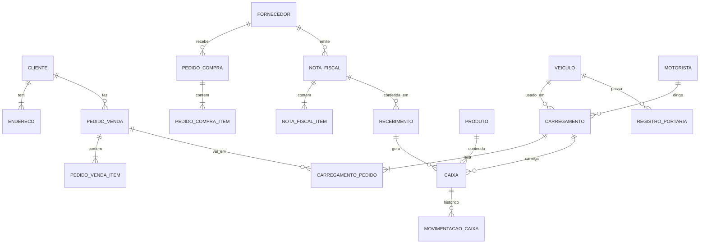

# 02 — Entidades (≈ 30 min)

**Objetivo:** criar as classes que viram as tabelas do banco.

Crie a pasta `src/Pim.Core/Entidades/` e, dentro dela, um arquivo por classe.

## Mapa das entidades



> **Vindos do ERP (simulado):** Cliente, Endereco, Fornecedor, Produto, PedidoCompra, NotaFiscal, PedidoVenda e seus itens.
> **Do nosso sistema:** Usuario, Recebimento, Caixa, MovimentacaoCaixa, Veiculo, Motorista, Carregamento, CarregamentoPedido, RegistroPortaria.

## Enums (situações e status)

**`src/Pim.Core/Entidades/Enums.cs`**

```csharp
namespace Pim.Core.Entidades;

public enum Perfil { Gerente, Programador, Frota, Comercial, Conferente, Operador, Porteiro, Motorista }

public enum StatusPedido { Aberto, EmCarregamento, EmRota, Entregue, NaoEntregue, Cancelado }

public enum SituacaoVeiculo { Disponivel, EmRota, EmManutencao }

public enum StatusCarregamento { Planejado, EmRota, Encerrado, Cancelado }

public enum ResultadoEntrega { Pendente, Entregue, NaoEntregue }

public enum StatusRecebimento { EmAndamento, AguardandoAprovacao, Finalizado }

public enum StatusCaixa { NoArmazem, Carregada, EmRota, Entregue }

public enum TipoMovimentacao { Entrada, Carregamento, Saida, Entrega, Retorno }

public enum TipoRegistroPortaria { ChegadaFornecedor, SaidaFornecedor, SaidaFrota, VoltaFrota }
```

## Acesso

**`src/Pim.Core/Entidades/Usuario.cs`**

```csharp
namespace Pim.Core.Entidades;

public class Usuario
{
    public int Id { get; set; }
    public string Nome { get; set; } = "";
    public string Login { get; set; } = "";
    public string SenhaHash { get; set; } = "";
    public Perfil Perfil { get; set; }
    public bool Ativo { get; set; } = true;
}
```

## Dados do ERP

**`src/Pim.Core/Entidades/Cliente.cs`**

```csharp
namespace Pim.Core.Entidades;

public class Cliente
{
    public int Id { get; set; }
    public string Nome { get; set; } = "";
    public string CpfCnpj { get; set; } = "";
    public string? Telefone { get; set; }

    public List<Endereco> Enderecos { get; set; } = new();
}
```

**`src/Pim.Core/Entidades/Endereco.cs`**

```csharp
namespace Pim.Core.Entidades;

public class Endereco
{
    public int Id { get; set; }
    public int ClienteId { get; set; }
    public Cliente? Cliente { get; set; }

    public string Logradouro { get; set; } = "";
    public string Numero { get; set; } = "";
    public string Bairro { get; set; } = "";
    public string Cidade { get; set; } = "";
    public string Uf { get; set; } = "";
    public string Cep { get; set; } = "";

    public override string ToString() => $"{Logradouro}, {Numero} - {Bairro}, {Cidade}/{Uf}";
}
```

**`src/Pim.Core/Entidades/Fornecedor.cs`**

```csharp
namespace Pim.Core.Entidades;

public class Fornecedor
{
    public int Id { get; set; }
    public string Nome { get; set; } = "";
    public string Cnpj { get; set; } = "";
}
```

**`src/Pim.Core/Entidades/Produto.cs`**

```csharp
namespace Pim.Core.Entidades;

public class Produto
{
    public int Id { get; set; }
    public string Codigo { get; set; } = "";      // código de barras do fornecedor (EAN)
    public string Descricao { get; set; } = "";
}
```

**`src/Pim.Core/Entidades/PedidoCompra.cs`**

```csharp
namespace Pim.Core.Entidades;

public class PedidoCompra
{
    public int Id { get; set; }
    public int Numero { get; set; }
    public int FornecedorId { get; set; }
    public Fornecedor? Fornecedor { get; set; }
    public DateTime DataEmissao { get; set; }

    public List<PedidoCompraItem> Itens { get; set; } = new();
}
```

**`src/Pim.Core/Entidades/PedidoCompraItem.cs`**

```csharp
namespace Pim.Core.Entidades;

public class PedidoCompraItem
{
    public int Id { get; set; }
    public int PedidoCompraId { get; set; }
    public PedidoCompra? PedidoCompra { get; set; }
    public int ProdutoId { get; set; }
    public Produto? Produto { get; set; }
    public int Quantidade { get; set; }
}
```

**`src/Pim.Core/Entidades/NotaFiscal.cs`**

```csharp
namespace Pim.Core.Entidades;

public class NotaFiscal
{
    public int Id { get; set; }
    public int Numero { get; set; }
    public string Chave { get; set; } = "";       // 44 dígitos (código de barras do DANFE)
    public int FornecedorId { get; set; }
    public Fornecedor? Fornecedor { get; set; }
    public int? PedidoCompraId { get; set; }
    public PedidoCompra? PedidoCompra { get; set; }
    public DateTime DataEmissao { get; set; }
    public int QuantidadeVolumes { get; set; }

    public List<NotaFiscalItem> Itens { get; set; } = new();
}
```

**`src/Pim.Core/Entidades/NotaFiscalItem.cs`**

```csharp
namespace Pim.Core.Entidades;

public class NotaFiscalItem
{
    public int Id { get; set; }
    public int NotaFiscalId { get; set; }
    public NotaFiscal? NotaFiscal { get; set; }
    public int ProdutoId { get; set; }
    public Produto? Produto { get; set; }
    public int Quantidade { get; set; }
}
```

**`src/Pim.Core/Entidades/PedidoVenda.cs`**

```csharp
namespace Pim.Core.Entidades;

public class PedidoVenda
{
    public int Id { get; set; }
    public int Numero { get; set; }
    public int ClienteId { get; set; }
    public Cliente? Cliente { get; set; }
    public int EnderecoId { get; set; }              // endereço de entrega
    public Endereco? Endereco { get; set; }
    public DateTime DataEmissao { get; set; }
    public StatusPedido Status { get; set; } = StatusPedido.Aberto;

    public List<PedidoVendaItem> Itens { get; set; } = new();

    // não vai para o banco: só funciona com .Include(p => p.Itens)
    public int TotalCaixas => Itens.Sum(i => i.Quantidade);
}
```

**`src/Pim.Core/Entidades/PedidoVendaItem.cs`**

```csharp
namespace Pim.Core.Entidades;

public class PedidoVendaItem
{
    public int Id { get; set; }
    public int PedidoVendaId { get; set; }
    public PedidoVenda? PedidoVenda { get; set; }
    public int ProdutoId { get; set; }
    public Produto? Produto { get; set; }
    public int Quantidade { get; set; }
}
```

## Entrada de caixas

**`src/Pim.Core/Entidades/Recebimento.cs`**

```csharp
namespace Pim.Core.Entidades;

public class Recebimento
{
    public int Id { get; set; }
    public int NotaFiscalId { get; set; }
    public NotaFiscal? NotaFiscal { get; set; }

    public int ConferenteId { get; set; }
    public Usuario? Conferente { get; set; }

    public DateTime DataInicio { get; set; }
    public DateTime? DataFim { get; set; }
    public StatusRecebimento Status { get; set; } = StatusRecebimento.EmAndamento;

    // RN03: só o gerente aceita entrada com diferença
    public int? AprovadoPorId { get; set; }
    public Usuario? AprovadoPor { get; set; }
    public string? Justificativa { get; set; }

    public List<Caixa> Caixas { get; set; } = new();
}
```

**`src/Pim.Core/Entidades/Caixa.cs`**

```csharp
namespace Pim.Core.Entidades;

public class Caixa
{
    public int Id { get; set; }
    public string Codigo { get; set; } = "";      // RN01: código único da etiqueta (ex.: CX00000001)

    public int ProdutoId { get; set; }
    public Produto? Produto { get; set; }

    public int RecebimentoId { get; set; }
    public Recebimento? Recebimento { get; set; }

    // preenchidos quando a caixa é bipada no carregamento
    public int? PedidoVendaId { get; set; }
    public PedidoVenda? PedidoVenda { get; set; }
    public int? CarregamentoId { get; set; }
    public Carregamento? Carregamento { get; set; }

    public StatusCaixa Status { get; set; } = StatusCaixa.NoArmazem;

    public List<MovimentacaoCaixa> Movimentacoes { get; set; } = new();
}
```

**`src/Pim.Core/Entidades/MovimentacaoCaixa.cs`**

```csharp
namespace Pim.Core.Entidades;

// Cada bipagem de uma caixa gera uma movimentação (histórico / rastreabilidade)
public class MovimentacaoCaixa
{
    public int Id { get; set; }
    public int CaixaId { get; set; }
    public Caixa? Caixa { get; set; }
    public TipoMovimentacao Tipo { get; set; }
    public DateTime DataHora { get; set; }
    public int UsuarioId { get; set; }
    public Usuario? Usuario { get; set; }
    public int? CarregamentoId { get; set; }
    public Carregamento? Carregamento { get; set; }
}
```

## Frota e carregamento

**`src/Pim.Core/Entidades/Veiculo.cs`**

```csharp
using System.ComponentModel.DataAnnotations;

namespace Pim.Core.Entidades;

public class Veiculo
{
    public int Id { get; set; }

    [Required(ErrorMessage = "Informe a placa.")]
    [StringLength(7, MinimumLength = 7, ErrorMessage = "A placa tem 7 caracteres, sem traço.")]
    public string Placa { get; set; } = "";

    [Required(ErrorMessage = "Informe o modelo.")]
    public string Modelo { get; set; } = "";

    [Range(1, 1000, ErrorMessage = "O limite deve ser entre 1 e 1000 caixas.")]
    public int LimiteCaixas { get; set; }                       // RN09

    public SituacaoVeiculo Situacao { get; set; } = SituacaoVeiculo.Disponivel;   // RN16
}
```

**`src/Pim.Core/Entidades/Motorista.cs`**

```csharp
using System.ComponentModel.DataAnnotations;

namespace Pim.Core.Entidades;

public class Motorista
{
    public int Id { get; set; }

    [Required(ErrorMessage = "Informe o nome.")]
    public string Nome { get; set; } = "";

    [Required(ErrorMessage = "Informe o CPF.")]
    [StringLength(11, MinimumLength = 11, ErrorMessage = "O CPF tem 11 números, sem pontos e traço.")]
    public string Cpf { get; set; } = "";

    [Required(ErrorMessage = "Informe o número da CNH.")]
    public string NumeroCnh { get; set; } = "";

    [DataType(DataType.Date)]
    public DateTime ValidadeCnh { get; set; }

    // login do motorista no aplicativo
    public int? UsuarioId { get; set; }
    public Usuario? Usuario { get; set; }

    public bool CnhValidaEm(DateTime data) => ValidadeCnh.Date >= data.Date;   // RN18
}
```

**`src/Pim.Core/Entidades/Carregamento.cs`**

```csharp
namespace Pim.Core.Entidades;

// RN08: veículo + motorista + data + pedidos
public class Carregamento
{
    public int Id { get; set; }
    public int VeiculoId { get; set; }
    public Veiculo? Veiculo { get; set; }
    public int MotoristaId { get; set; }
    public Motorista? Motorista { get; set; }
    public DateTime DataPrevista { get; set; }
    public StatusCarregamento Status { get; set; } = StatusCarregamento.Planejado;
    public DateTime? DataSaida { get; set; }
    public DateTime? DataVolta { get; set; }

    public List<CarregamentoPedido> Pedidos { get; set; } = new();
    public List<Caixa> Caixas { get; set; } = new();
}
```

**`src/Pim.Core/Entidades/CarregamentoPedido.cs`**

```csharp
namespace Pim.Core.Entidades;

// Pedidos do carregamento + resultado da entrega (RN13)
public class CarregamentoPedido
{
    public int Id { get; set; }
    public int CarregamentoId { get; set; }
    public Carregamento? Carregamento { get; set; }
    public int PedidoVendaId { get; set; }
    public PedidoVenda? PedidoVenda { get; set; }

    public ResultadoEntrega Resultado { get; set; } = ResultadoEntrega.Pendente;
    public string? Motivo { get; set; }
    public DateTime? DataRegistro { get; set; }
}
```

**`src/Pim.Core/Entidades/RegistroPortaria.cs`**

```csharp
namespace Pim.Core.Entidades;

// RN12: registra veículo, motorista e horário na saída e na volta
public class RegistroPortaria
{
    public int Id { get; set; }
    public TipoRegistroPortaria Tipo { get; set; }
    public DateTime DataHora { get; set; }

    // veículo da frota (saída/volta)
    public int? VeiculoId { get; set; }
    public Veiculo? Veiculo { get; set; }
    public int? CarregamentoId { get; set; }
    public Carregamento? Carregamento { get; set; }

    // veículo de fornecedor não tem cadastro: guarda só a placa
    public string? PlacaFornecedor { get; set; }

    public int PorteiroId { get; set; }
    public Usuario? Porteiro { get; set; }
}
```

## O que observar
- `int ClienteId` + `Cliente? Cliente` é o padrão do EF Core: o primeiro vira a **chave estrangeira** e o segundo serve para navegar no código.
- Os atributos `[Required]`, `[Range]` etc. em `Veiculo` e `Motorista` validam os formulários sozinhos.
- `TotalCaixas` em `PedidoVenda` **não vai para o banco**: é calculado a partir dos itens.

## Pronto quando
- [ ] `dotnet build` termina com `0 Error(s)`
